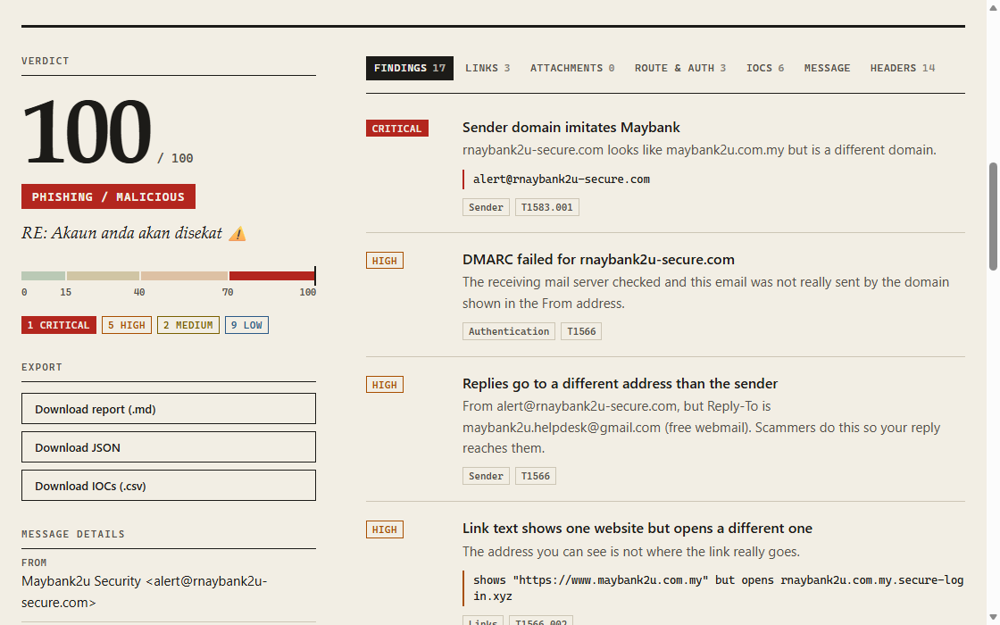

# HookScope

**Drop in a suspicious email. Get a clear phishing verdict in seconds. Nothing leaves your browser.**

HookScope is a free, open source phishing email analyzer. You give it an `.eml` file and it checks the sender, the links, the attachments and the wording, then tells you how risky the email is and why, in plain language. It also pulls out the indicators (IOCs) a SOC analyst needs for blocking and reporting.

It runs 100% in the browser. There is no server, no account and no API key. A strict Content Security Policy stops the page from sending your email anywhere, so it is safe to use on real company mail.



## Why I built this

Most phishing analysis tools either need paid API keys, upload your email to someone else's server, or only show raw headers that a normal user cannot read. I wanted something that:

* a SOC analyst can use to triage a reported email in under a minute
* a normal staff member can understand without security knowledge
* can be hosted for free on GitHub Pages and used by anyone
* knows about the scams we actually see in Malaysia (fake Maybank2u, LHDN, Pos Laju, TNB and Touch 'n Go messages, written in Bahasa Malaysia or English)

## What it checks

| Area | Checks |
|:--|:--|
| **Sender** | Look-alike domains (`rnaybank2u`, `micros0ft`, `pаypal` with a Cyrillic "а"), brand name in a domain the brand does not own, display name pretending to be a brand or showing a fake email address, Reply-To that sends your answer somewhere else, senior titles (CEO, Datuk, Director) on free webmail |
| **Authentication** | Reads SPF, DKIM and DMARC results recorded by the receiving server, and checks if they line up with the From address |
| **Delivery route** | Rebuilds the hop-by-hop path from the `Received` headers, finds the origin IP, flags odd timestamps |
| **Links** | Link text that shows one site but opens another, the `@` trick, raw and disguised IPs, punycode, URL shorteners, free hosting often abused for phishing (pages.dev, web.app, ipfs and more), redirects, risky downloads including Android `.apk`, Telegram bot links |
| **Attachments** | Real file type vs file name, fake double extensions (`invoice.pdf.html`), hidden right-to-left characters, macros in Office files (new and old format), remote template injection, password protected archives and what is inside them, PDF JavaScript and auto actions, RTF exploits, HTML smuggling, fake login pages, ISO and LNK files, SHA-256 and SHA-1 hashes |
| **Content** | Pressure, login requests, payment and invoice lures, prizes, gift card requests, parcel scams, in **English and Bahasa Malaysia**. Fake "RE:" subjects, hidden text, forms and scripts inside the email |
| **Reported emails** | If a user forwards a phishing email "as attachment", HookScope analyzes the attached email too |

Every finding has a severity, a plain-language explanation, the evidence, and a MITRE ATT&CK technique ID where one applies.

## Exports

* **Markdown report**, ready to paste into a ticket (Jira, ServiceNow, GitHub issue)
* **JSON**, for scripts and SIEM pipelines
* **IOC list**, defanged for sharing (`hxxp://evil[.]com`) or raw for blocklists, plus CSV

Hashes and IPs have one-click lookup links for VirusTotal and AbuseIPDB. These only open when you click, and only the hash or IP is sent, never the file.

## Try it

### Option 1: Use it online (GitHub Pages)

This repo deploys itself to GitHub Pages on every push to `main`.

1. Push this project to a GitHub repository.
2. Go to **Settings, then Pages**, and under **Build and deployment** choose **GitHub Actions** as the source.
3. Push again (or run the "Deploy to GitHub Pages" workflow by hand). The tests run first, then the site goes live. GitHub shows the live link on the same Pages settings page.

### Option 2: Run it on your computer

You need [Node.js](https://nodejs.org) 20 or newer. There are no packages to install.

Download or clone this repo, then inside the folder run:

```bash
npm run serve
```

Then open http://localhost:8080 and click one of the sample emails.

### Option 3: Command line

The same engine works from the terminal, which is handy for scanning a folder of reported emails or plugging into a script.

```bash
node cli/hookscope.mjs samples/maybank-credential-phish.eml
node cli/hookscope.mjs samples/                       # scan every .eml in a folder
node cli/hookscope.mjs suspicious.eml --md > ticket.md # Markdown report
node cli/hookscope.mjs suspicious.eml --json           # full JSON
node cli/hookscope.mjs suspicious.eml --iocs           # defanged IOCs only
node cli/hookscope.mjs inbox/ --fail-above 40          # exit code 2 if anything scores 40 or more
```

## How the score works

Each check that fires adds points: critical 40, high 25, medium 12, low 5, info 0. The total is capped at 100.

| Score | Verdict |
|:--|:--|
| 0 to 14 | Low risk |
| 15 to 39 | Suspicious |
| 40 to 69 | Likely phishing |
| 70 to 100 | Phishing / malicious |

Passing SPF, DKIM and DMARC does **not** lower the score. A scammer who registers `rnaybank2u-secure.com` can pass all three on their own domain. Passing only proves the email came from the domain shown, not that the domain is honest.

## Sample emails

The `samples` folder has five safe test emails. They contain no real malware, the links point to made-up domains, and the Telegram bot token is fake.

| File | What it shows |
|:--|:--|
| `maybank-credential-phish.eml` | Look-alike bank domain, Malay urgency text, link text that lies, DMARC fail |
| `microsoft-html-smuggling.eml` | HTML attachment that builds a file from hidden data and posts passwords to a Telegram bot |
| `ceo-fraud-macro-docm.eml` | Boss impersonation from Gmail, macro document with remote template, locked zip with `.pdf.exe` |
| `user-report-forward.eml` | A staff member forwarding the bank phish to the SOC as an attachment |
| `legit-newsletter.eml` | A normal newsletter, to show the tool stays quiet on real mail |

## Project layout

```
index.html            Web app page
assets/               Styles and icon
src/
  engine.js           Runs every check and builds the result
  mime.js             Email (MIME) parser written from scratch
  headers.js          Sender, SPF / DKIM / DMARC and route checks
  domains.js          Look-alike detection, brand list, punycode
  urls.js             Link checks
  attachments.js      File type, archives, Office, PDF, RTF, HTML checks
  html.js             Safe HTML scanning (never renders anything)
  content.js          English and Bahasa Malaysia wording checks
  report.js           Markdown, JSON and IOC exports
  app.js              Browser interface
cli/                  Command line tool and local server
tests/                Automated tests (node --test)
samples/              Safe test emails
```

There are **zero dependencies**. Everything, including the MIME parser, ZIP reader and punycode decoder, is written in plain JavaScript so the code is easy to read and audit.

## Security design

* **No network calls.** The CSP allows the page to load only its own files. Your email is read with the browser's File API and stays in memory.
* **Email HTML is never rendered.** Message bodies and attachments are shown as text only, and every value is inserted with `textContent`, so a malicious email cannot run code in the analyzer.
* **Links are defanged** in the interface so they cannot be clicked by mistake.
* **Compressed content is inflated with the browser's built-in `DecompressionStream`**, with size limits, so zip bombs cannot freeze the page.

## Limits

* Outlook `.msg` files are not supported yet. Save as `.eml` or paste the message source.
* The tool does not look up domain age or reputation, because that would need an online service. Use the lookup links for that.
* Results are a guide for a human. A clean score does not prove an email is safe.

## Roadmap

* `.msg` support
* QR code detection in image attachments (quishing)
* Custom brand list for your own company domain
* YARA-style custom rules loaded from a file

## Running the tests

```bash
npm test
```

## Licence

MIT. See [LICENSE](LICENSE).
